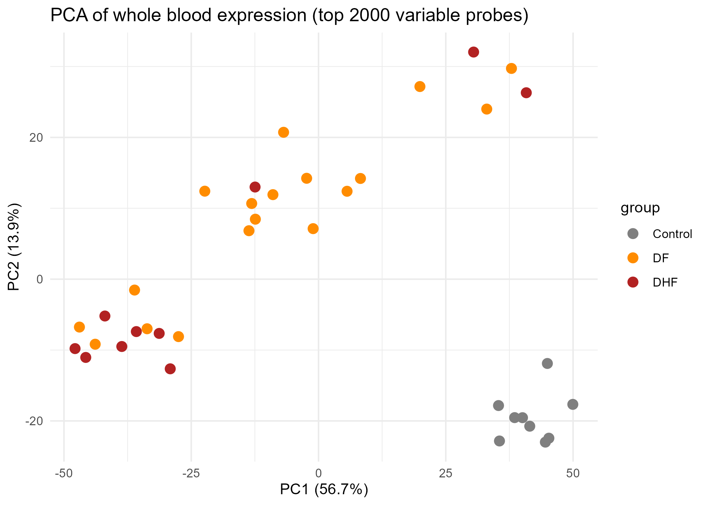
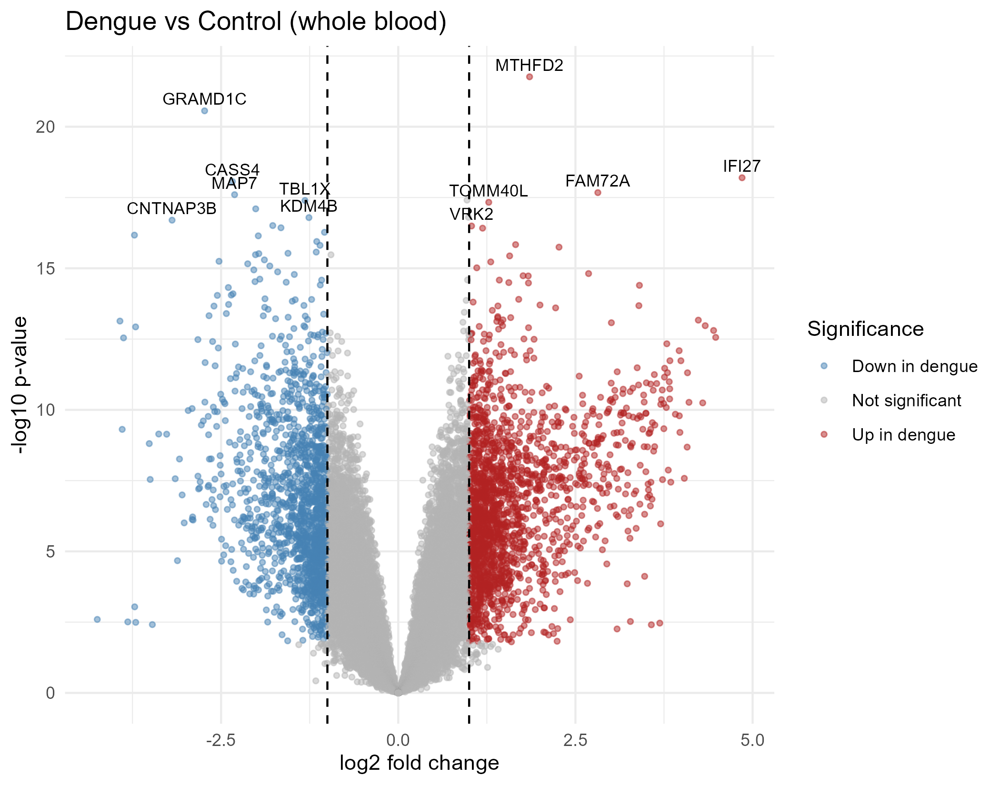
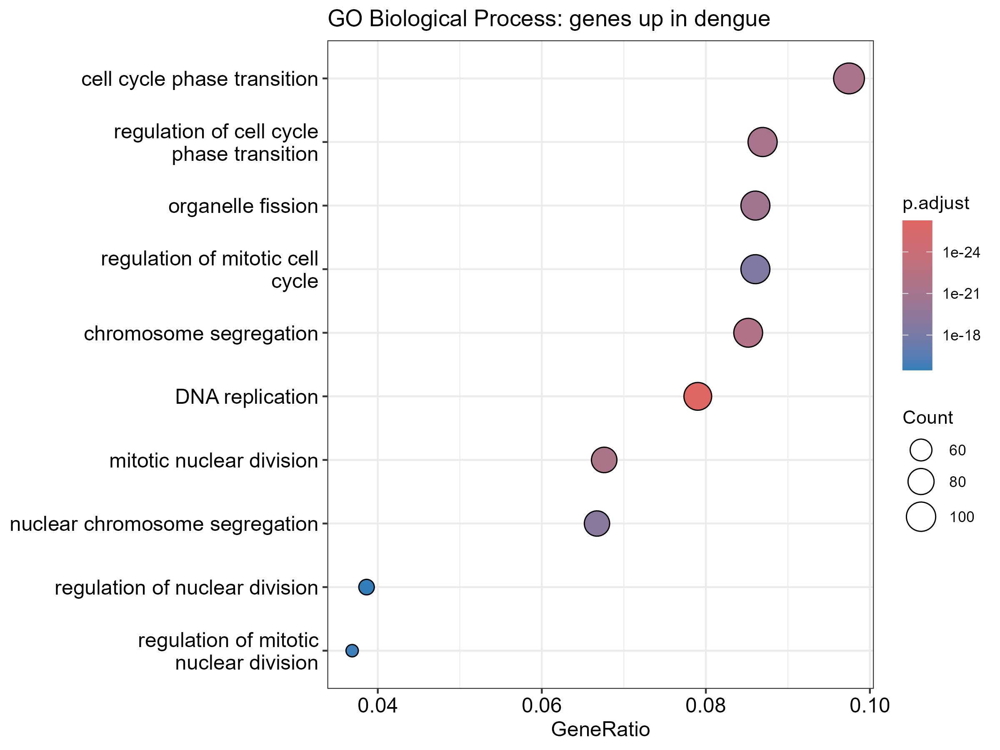
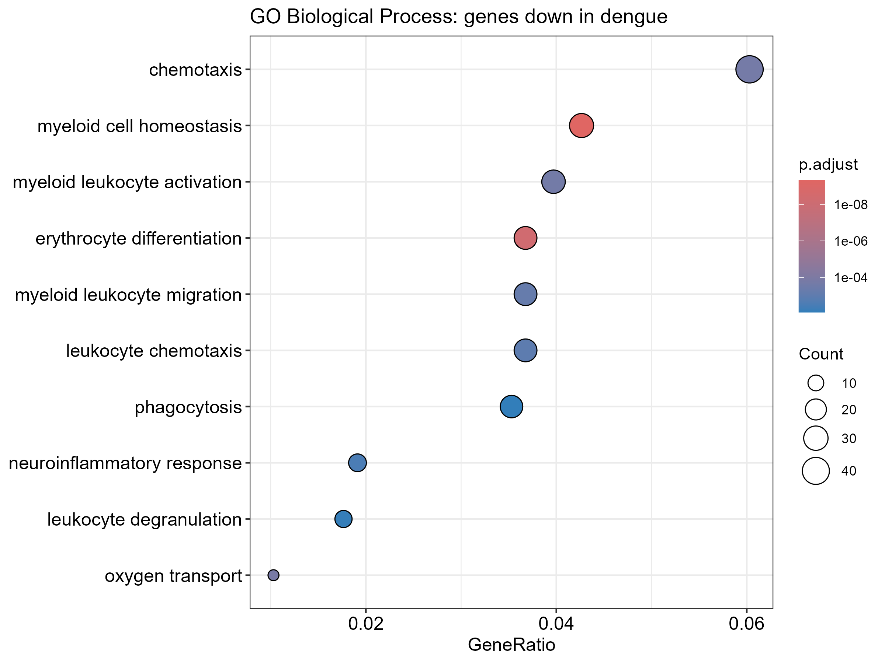
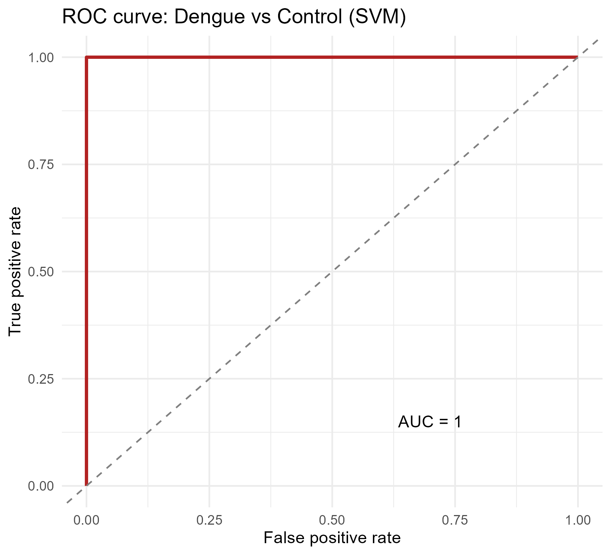
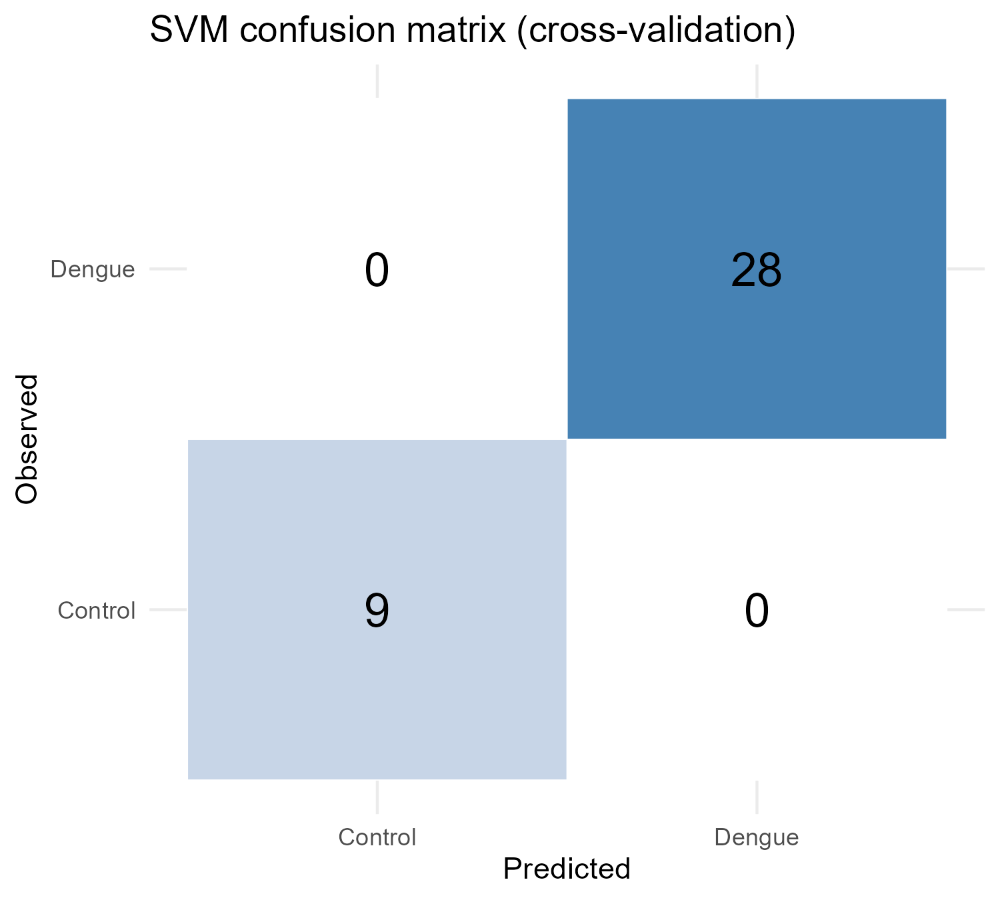

# Host Blood Transcriptome in Dengue: Differential Expression, Pathway Enrichment and Classification (GSE51808)

**Student registration number:** 2021ICT114
**Author:** Sewmini Dilshani Dewasurendra
**Repository:** https://github.com/SewminiDilshani/2021ICT114

---

## 1. Abstract

Dengue is a mosquito-borne viral disease that burdens many tropical countries, and reliable blood biomarkers could support earlier diagnosis. Using the public whole blood microarray dataset GSE51808 (9 healthy controls and 28 acute dengue patients), I asked which host genes change during acute dengue, which biological processes they represent, and whether gene expression alone can classify patients. limma identified 1,844 up-regulated and 1,453 down-regulated probes (adjusted P < 0.05, |log2FC| ≥ 1), led by IFI27. Up-regulated genes were enriched for cell-cycle and DNA replication processes, and down-regulated genes for myeloid, erythroid and chemotaxis processes. A linear SVM, with feature selection inside cross-validation, separated patients from controls perfectly, but the small sample and lack of external validation make this a proof of concept. Dengue fever and dengue hemorrhagic fever could not be distinguished.

## 2. Introduction

Dengue is caused by four virus serotypes (DENV-1 to DENV-4) transmitted by *Aedes* mosquitoes. The illness ranges from mild dengue fever (DF) to the more severe dengue hemorrhagic fever (DHF). It is common in tropical countries, including Sri Lanka, and there is no specific antiviral treatment. Early recognition is difficult because the first days look like many other fevers.

During infection, the immune system changes the activity of many genes in blood cells. Measuring these changes with microarrays can show which genes and pathways respond, and some of these genes may work as biomarkers. Public repositories such as the NCBI Gene Expression Omnibus (GEO) allow this to be studied without collecting new samples.

**Aim.** To analyse a public whole blood dataset from dengue patients and healthy controls in R, and to find the genes, biological processes and predictive signal linked to acute dengue.

**Hypothesis.** Gene expression in whole blood differs between acute dengue patients and healthy controls, the differentially expressed genes are enriched in immune and cell-response pathways, and the expression profile can predict infection status.

## 3. Data

| Item | Description |
|---|---|
| Source | NCBI GEO, accession **GSE51808** ("Systems biological analysis of immunity to dengue") |
| Original study | Kwissa et al. (2014), patients at Siriraj Hospital, Bangkok, Thailand |
| Platform | Affymetrix microarray, GPL13158 |
| Size | 56 samples, 54,715 probes (whole blood) |
| Groups | Healthy control (9), DF (18), DHF (10), convalescent (19) |

Acute samples were collected between days 2 and 9 after symptom onset. The 19 convalescent samples come from patients sampled again four weeks or more after discharge. This matches the metadata: the 56 samples have only 37 unique subject IDs (28 patients plus 9 controls). Convalescent samples are therefore repeated measurements of the same people, so they were not used as an independent group.

The variables used were `status:ch1` (control, DF, DHF, convalescent), `subject id:ch1` and the probe annotation (`Gene Symbol`, `ENTREZ_GENE_ID`).

**Ethics and licensing.** The data are public and were downloaded from GEO with the GEOquery package. They contain only coded subject numbers and no direct identifiers. Consent and sample collection were handled by the original authors, and the dataset is cited in the References.

## 4. Methods

The workflow is in the `code/` folder and runs in order with `code/run_all.R`. All analysis was done in R 4.6.2.

| Step | Script | Purpose |
|---|---|---|
| 1 | `01_download_data.R` | Download GSE51808 with `GEOquery` |
| 2 | `02_check_labels.R` | Check labels, subject IDs, value range |
| 3 | `03_qc_cleaning.R` | QC, sample selection, probe filtering |
| 4 | `04_eda.R` | PCA and heatmaps |
| 5 | `05_limma.R` | Differential expression, volcano plot |
| 6 | `06_enrichment.R` | GO enrichment (`clusterProfiler`) |
| 7 | `07_classification.R` | SVM with cross-validation (`e1071`) |

**QC and cleaning.** Expression values ranged from 2.0 to 14.6, which shows they were already log2-scaled, so no further transformation was applied. There were no missing values. The main analysis used the 9 controls and the 28 acute patients (DF and DHF together, called "Dengue"). A probe was kept only if its log2 expression was above 3.5 in at least 9 samples (the size of the smallest group), which left 44,042 of 54,715 probes.

**Exploratory analysis.** PCA was run on the 2,000 most variable probes after scaling. A sample correlation heatmap and a heatmap of the 50 most variable probes were drawn with `pheatmap`.

**Differential expression.** I used `limma`, which fits a linear model to each probe and moderates the variance with an empirical Bayes step, so it suits small samples. The model compared Dengue with Control. P values were adjusted with the Benjamini-Hochberg method, and a probe was significant at adjusted P < 0.05 and |log2 fold change| ≥ 1. The same method was used for DHF vs DF as an extra comparison.

**GO enrichment.** Probes were mapped to Entrez IDs, and for genes with several probes the one with the smallest P value was kept (18,143 genes). Over-representation analysis of GO Biological Process terms was run separately for up-regulated (1,269) and down-regulated (796) genes with `enrichGO`. All 18,143 tested genes formed the background, the cut-off was adjusted P < 0.05, and similar terms were merged with `simplify`.

**Classification.** A linear SVM predicted Control vs Dengue. Because there are only 37 samples, I used 5-fold stratified cross-validation repeated 10 times. In every fold, the top 50 probes were selected with `limma` on the training samples only, and test data were scaled with the training mean and standard deviation. This avoids data leakage, where test samples influence gene selection and make accuracy look better than it is. Class weights handled the smaller number of controls. I report accuracy, sensitivity, specificity and AUC (Dengue is the positive class). The baseline accuracy is 75.7%, which is what always predicting "Dengue" would give.

## 5. Results

### 5.1 Exploratory analysis

PC1 explained 56.7% of the variance and PC2 explained 13.9% (Figure 1), so one dominant source of variation drives the data.



*Figure 1. PCA of the 37 samples (Control, DF, DHF) using the 2,000 most variable probes.*

### 5.2 Differential expression: dengue vs control

Of 44,042 tested probes, **1,844 were up-regulated** and **1,453 were down-regulated** in dengue, and 40,745 were not significant (Figure 2, Table 1).



*Figure 2. Volcano plot of dengue vs control. Red: up in dengue, blue: down in dengue (adjusted P < 0.05 and |log2FC| ≥ 1).*

*Table 1. The ten probes with the smallest adjusted P value.*

| Gene | log2FC | Mean expression | Adjusted P |
|---|---|---|---|
| MTHFD2 | 1.85 | 10.10 | 7.6e-18 |
| GRAMD1C | -2.73 | 4.95 | 6.0e-17 |
| IFI27 | 4.85 | 11.70 | 9.3e-15 |
| CASS4 | -2.34 | 5.05 | 9.5e-15 |
| FAM72A | 2.82 | 7.66 | 1.8e-14 |
| MAP7 | -2.31 | 5.59 | 1.8e-14 |
| PSMA4 | 0.97 | 11.17 | 2.2e-14 |
| TBL1X | -1.32 | 9.90 | 2.2e-14 |
| TOMM40L | 1.28 | 7.59 | 2.3e-14 |
| CAMK1D | -2.01 | 8.36 | 3.5e-14 |

IFI27 has the largest fold change in this list (log2FC 4.85, about 29-fold) and a high average expression. PSMA4 has a very small adjusted P value but a log2FC just under 1, so it does not pass the fold-change threshold.

### 5.3 DHF vs DF

When DHF (10 samples) was compared with DF (18 samples), **no probe passed adjusted P < 0.05**. Only 620 probes had a raw P < 0.01, which is not reliable evidence after so many tests. No significant DF vs DHF difference was found in this dataset.

### 5.4 GO enrichment

Genes up-regulated in dengue were strongly enriched for cell division, with DNA replication (90 genes, adjusted P = 5.6e-27), chromosome segregation, mitotic nuclear division and cell cycle phase transition at the top (Figure 3).



*Figure 3. Top GO Biological Process terms among genes up-regulated in dengue.*

Down-regulated genes were enriched for myeloid cell homeostasis, erythrocyte differentiation, oxygen transport, chemotaxis, leukocyte activation and phagocytosis (Figure 4). Full tables are in `results/`.



*Figure 4. Top GO Biological Process terms among genes down-regulated in dengue.*

### 5.5 Classification

The SVM classified every sample correctly in all 10 cross-validation repeats (Table 2, Figures 5 and 6), compared with a baseline accuracy of 0.757.

*Table 2. Cross-validated SVM performance (10 × 5-fold CV, top 50 probes chosen inside each fold).*

| Metric | Mean | SD |
|---|---|---|
| Accuracy | 1.000 | 0.000 |
| Sensitivity | 1.000 | 0.000 |
| Specificity | 1.000 | 0.000 |
| AUC | 1.000 | 0.000 |



*Figure 5. ROC curve of the SVM (predictions averaged over the repeats).*



*Figure 6. Confusion matrix (average per repeat): 9 of 9 controls and 28 of 28 patients correctly classified.*

## 6. Discussion

**Main findings.** Acute dengue is linked to a large change in whole blood gene expression, with about 3,300 probes passing the thresholds. IFI27, the clearest example, is a well-known interferon-stimulated gene, so its strong increase fits an antiviral response. The classifier result agrees: the infection signal is strong enough to separate patients from controls easily.

**Biological interpretation.** The cell-cycle and DNA replication terms suggest that more cells in the blood of acute patients are dividing. The original study reported expansion of CD14+CD16+ monocytes and B cell differentiation into plasmablasts, so proliferating immune cells are a possible explanation. This is an interpretation only, because whole blood expression cannot show which cell type is responsible. The down-regulated terms (erythrocyte, oxygen transport, myeloid) are probably affected by changes in the *proportions* of blood cell types, so some differences may reflect composition rather than changed gene activity.

**DHF vs DF.** With only 10 and 18 samples, power is low, so this result means "not detected here", not "no difference exists".

**Limitations.**
- The sample is small (9 controls, 28 patients) from one hospital, one season and one country.
- Controls and patients may have been processed differently, so a batch or cohort effect cannot be excluded. Age, sex and day of illness were not in the model.
- The perfect SVM result needs caution. Gene selection was inside the cross-validation, so there is no leakage, but there is no independent test set, and a very strong group difference with few samples can give very high accuracy. Other febrile illnesses were not tested, so performance in practice would likely be lower.
- The thresholds (adjusted P < 0.05, |log2FC| ≥ 1, expression > 3.5 in 9 samples) are common but arbitrary.

**Implications.** The host blood response to dengue is strong enough to measure, and the top genes are candidates for further biomarker study. This analysis is not a diagnostic test, because it was not validated on independent patients or other infections.

## 7. Conclusion and Future Work

Whole blood expression clearly separated acute dengue patients from healthy controls in GSE51808. Up-regulated genes pointed to cell proliferation, down-regulated genes to changes in myeloid and erythroid programmes, and no reliable DF vs DHF difference was found. The perfect cross-validated accuracy is a proof of concept only.

Future work: (1) validate the signature on other public dengue datasets that include other febrile diseases; (2) use a paired analysis of acute and convalescent samples from the same patients; (3) estimate blood cell proportions (deconvolution) to separate composition effects from expression changes; (4) study severity in a larger cohort, adjusting for age, sex and day of illness.

## 8. Reproducibility

```
2021ICT114/
├── README.md              # this report
├── 2021ICT114.Rproj
├── code/                  # scripts 01-07, run_all.R, analysis.Rmd, analysis.html
├── data/                  # downloaded and cleaned data (.rds)
├── figures/               # all figures (.png)
└── results/               # result tables (.csv)
```

1. Clone the repository and open `2021ICT114.Rproj` in RStudio (this sets the working directory).
2. Install the packages:

```r
install.packages(c("tidyverse", "e1071", "pheatmap", "rmarkdown", "knitr", "ggplot2"))
if (!require("BiocManager")) install.packages("BiocManager")
BiocManager::install(c("GEOquery", "limma", "clusterProfiler", "org.Hs.eg.db"))
```

3. Run everything with `source("code/run_all.R")`, or open `code/analysis.Rmd` and click **Knit** to produce `code/analysis.html`.

`01_download_data.R` downloads the data from GEO if they are not already in `data/`, so the first run needs internet. `set.seed(123)` is used where random numbers occur.

| Software | Version |
|---|---|
| R | 4.6.2 (2026-10-29) |
| GEOquery | 2.80.1 |
| limma | 3.68.5 |
| clusterProfiler | 4.20.3 |
| org.Hs.eg.db | 3.23.1 |
| e1071 | 1.7.17 |
| ggplot2 | 4.0.3 |
| pheatmap | 1.0.13 |

The full `sessionInfo()` is at the end of `code/analysis.html`.

## 9. References

Ashburner, M., et al. (2000) Gene Ontology: tool for the unification of biology. *Nature Genetics*, 25, 25–29.

Benjamini, Y. and Hochberg, Y. (1995) Controlling the false discovery rate. *Journal of the Royal Statistical Society: Series B*, 57(1), 289–300.

Carlson, M. org.Hs.eg.db: Genome wide annotation for Human. R package (Bioconductor).

Davis, S. and Meltzer, P.S. (2007) GEOquery: a bridge between the Gene Expression Omnibus (GEO) and BioConductor. *Bioinformatics*, 23(14), 1846–1847.

Edgar, R., Domrachev, M. and Lash, A.E. (2002) Gene Expression Omnibus: NCBI gene expression and hybridization array data repository. *Nucleic Acids Research*, 30(1), 207–210.

Kolde, R. pheatmap: Pretty Heatmaps. R package.

Kwissa, M., Nakaya, H.I., Onlamoon, N., et al. (2014) Dengue virus infection induces expansion of a CD14+CD16+ monocyte population that stimulates plasmablast differentiation. *Cell Host & Microbe*, 16(1), 115–127. Data: NCBI GEO accession GSE51808. https://www.ncbi.nlm.nih.gov/geo/query/acc.cgi?acc=GSE51808

Meyer, D., et al. e1071: Misc Functions of the Department of Statistics, Probability Theory Group (TU Wien). R package.

R Core Team. R: A language and environment for statistical computing. R Foundation for Statistical Computing, Vienna, Austria. https://www.R-project.org/

Ritchie, M.E., et al. (2015) limma powers differential expression analyses for RNA-sequencing and microarray studies. *Nucleic Acids Research*, 43(7), e47.

Wickham, H. (2016) *ggplot2: Elegant Graphics for Data Analysis*. Springer-Verlag, New York.

Wu, T., et al. (2021) clusterProfiler 4.0: A universal enrichment tool for interpreting omics data. *The Innovation*, 2(3), 100141.
