```{r setup, include=FALSE}
# Run all chunks from the project root folder (one level above code/)
knitr::opts_chunk$set(echo = TRUE, warning = FALSE, message = FALSE,
                      collapse = TRUE)
knitr::opts_knit$set(root.dir = normalizePath(".."))
set.seed(123)
```

# Overview

This notebook runs the full analysis pipeline for the public dataset
**GEO GSE51808** (whole blood microarray, dengue patients and healthy controls).
Each step is a script in the `code/` folder. The scripts save figures to
`figures/` and result tables to `results/`.

# Data import

The raw dataset is downloaded from GEO only if it is not already in `data/`.

```{r import}
if (!file.exists("data/GSE51808.rds")) source("code/01_download_data.R")
gse <- readRDS("data/GSE51808.rds")
cat("Probes:", nrow(Biobase::exprs(gse)),
    "| Samples:", ncol(Biobase::exprs(gse)), "\n")
```

# Sample labels

```{r labels}
source("code/02_check_labels.R")
```

# Quality control and cleaning

```{r qc}
source("code/03_qc_cleaning.R")
```

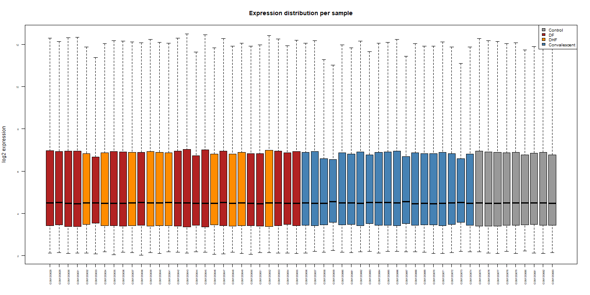

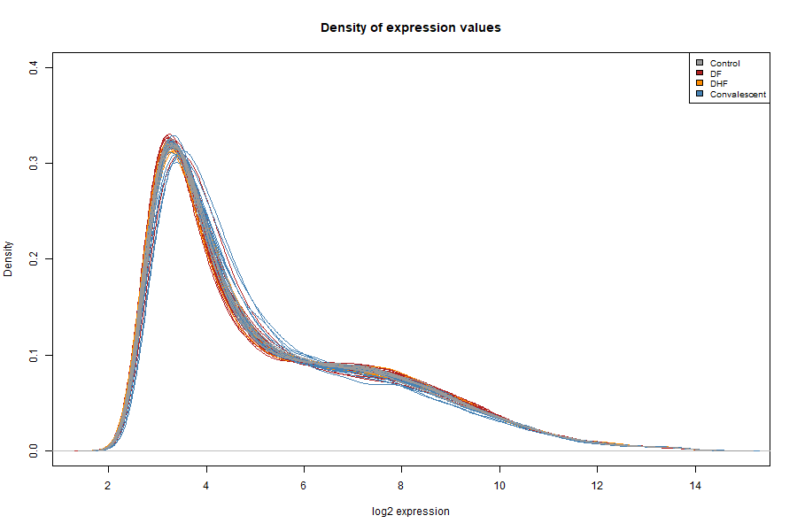

# Exploratory data analysis

```{r eda}
source("code/04_eda.R")
```

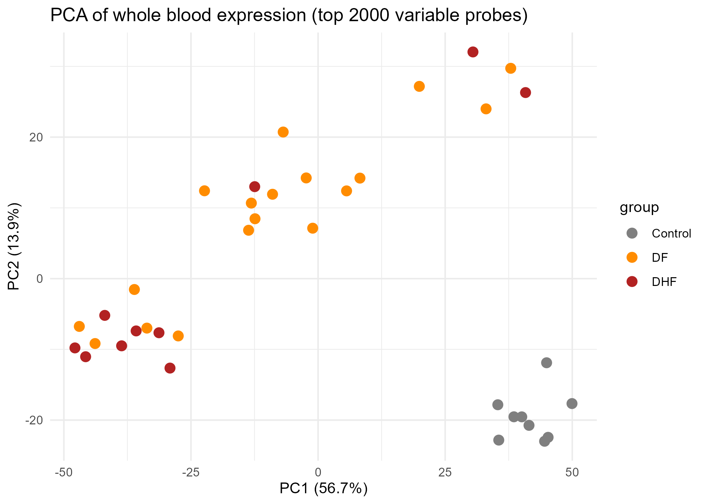

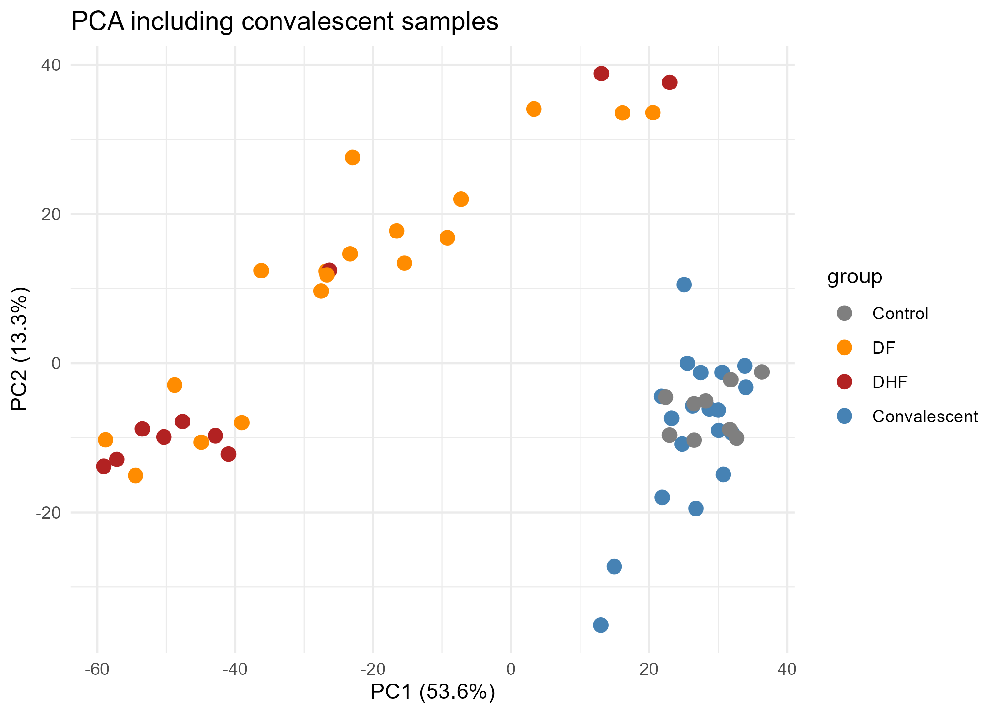

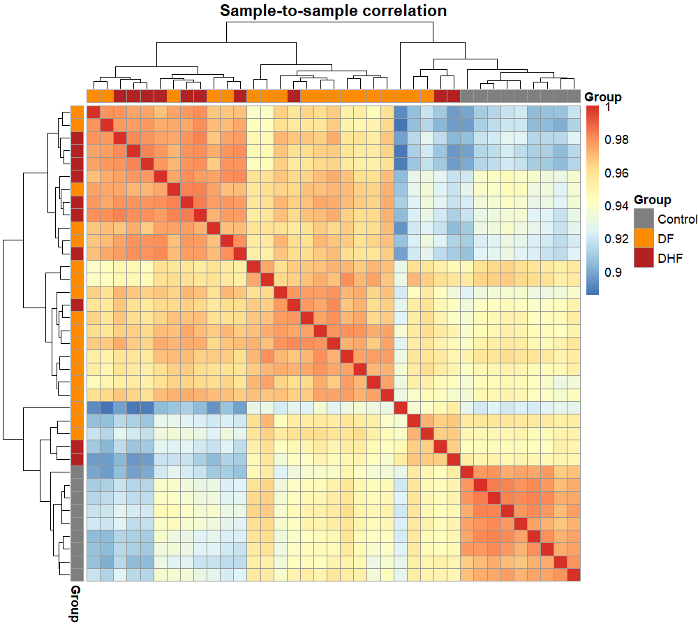

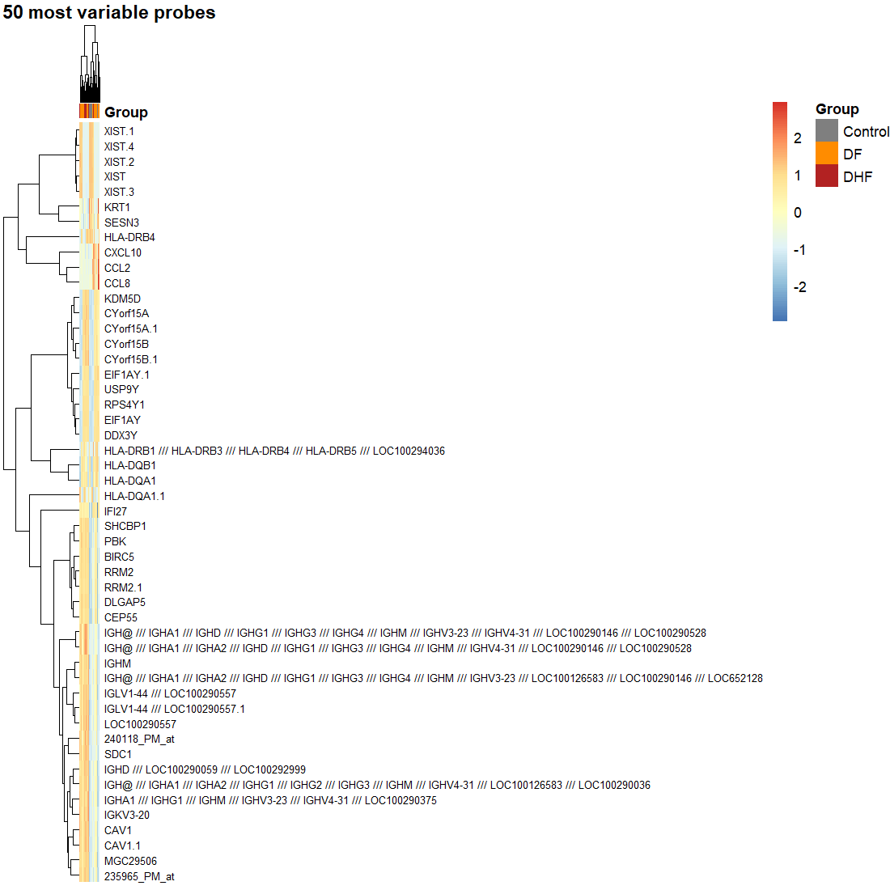

# Differential expression (limma)

```{r limma}
source("code/05_limma.R")
```

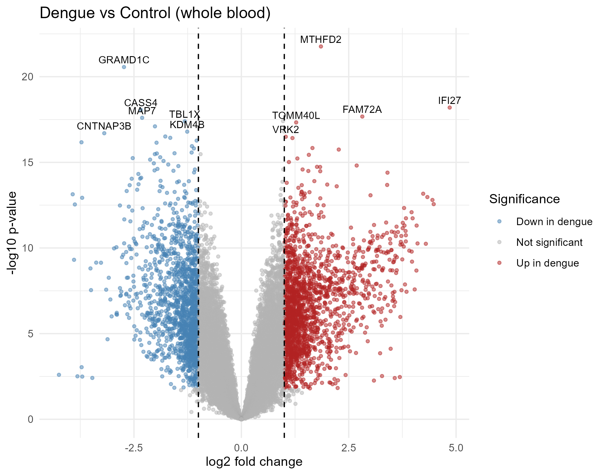

```{r limma-table}
res <- read.csv("results/DE_dengue_vs_control.csv")
knitr::kable(head(res[, c("Gene", "logFC", "AveExpr", "adj.P.Val")], 15),
             digits = 3, caption = "Top 15 differentially expressed probes")
```

# GO enrichment (Biological Process)

```{r go}
source("code/06_enrichment.R")
```

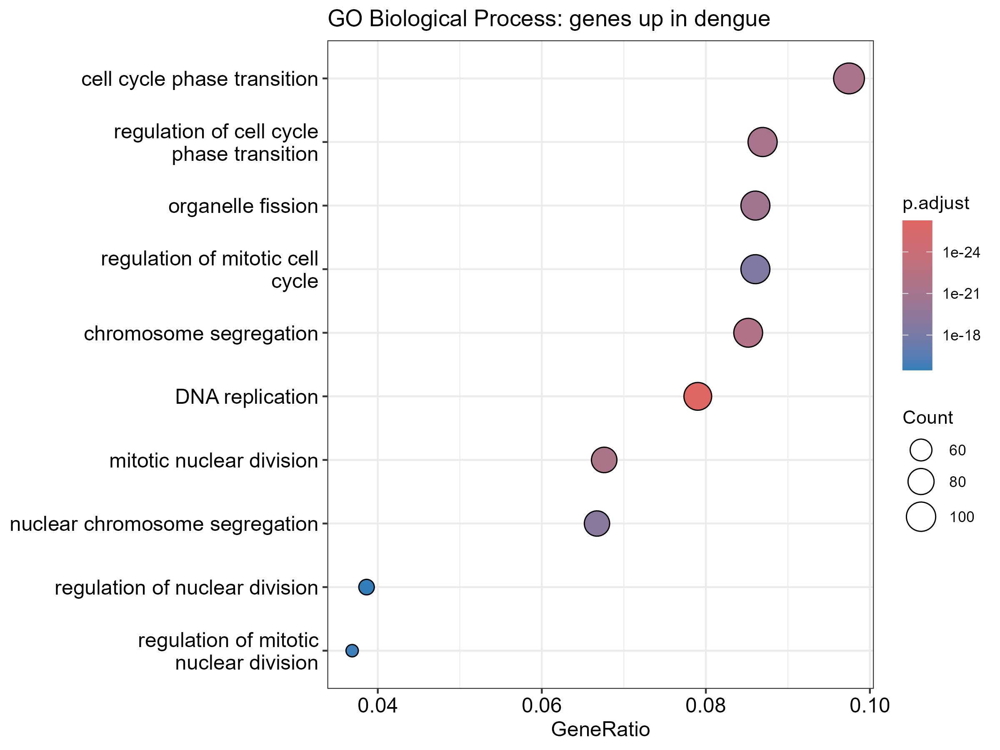

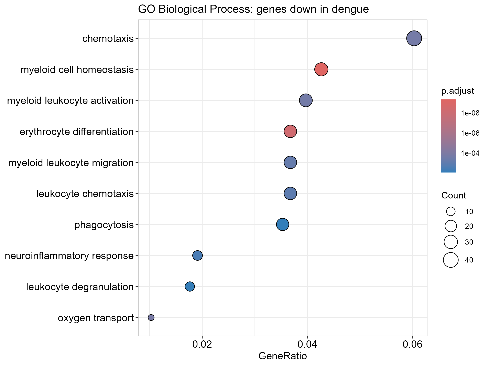

# SVM classification (Control vs Dengue)

Feature selection is done inside each cross-validation fold, so test samples
never influence the selected genes.

```{r svm}
source("code/07_classification.R")
```

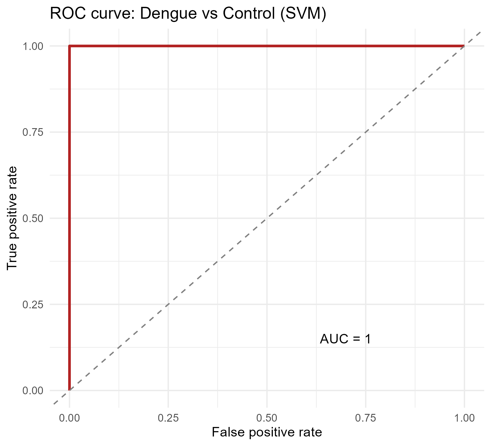

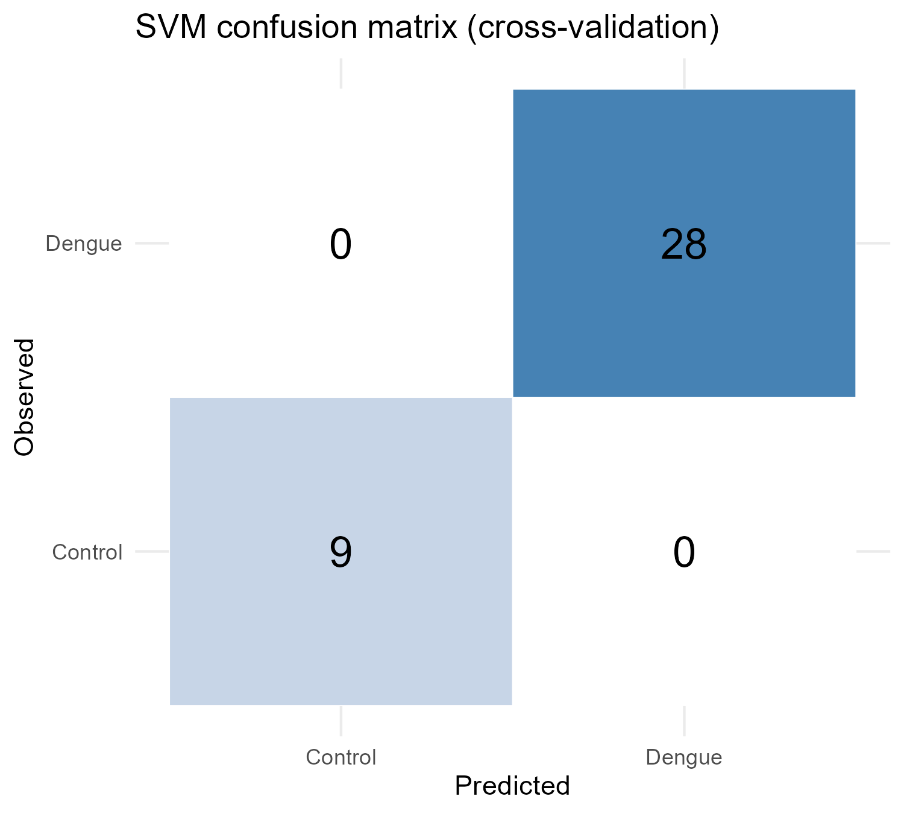

# Session information

```{r session}
sessionInfo()
```
